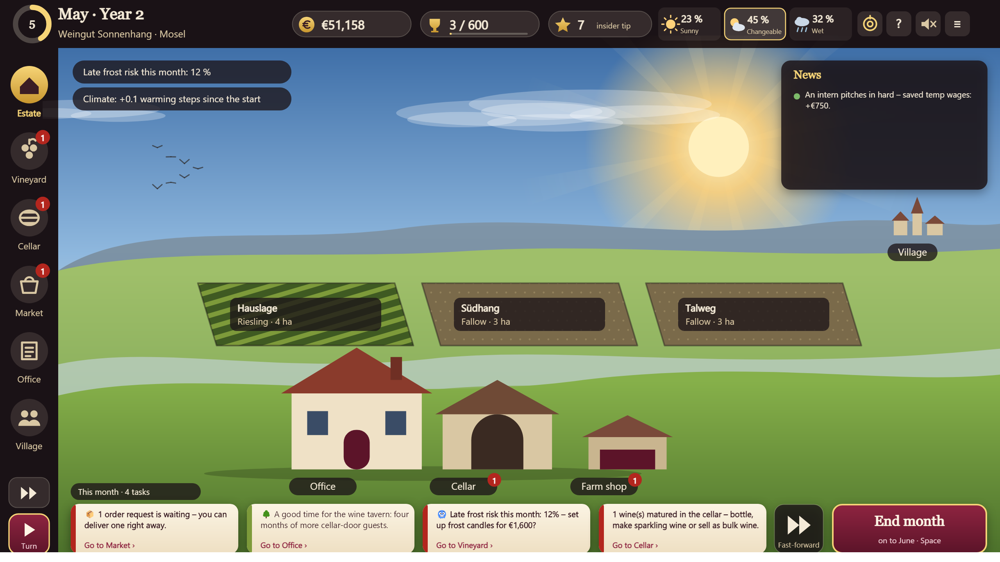

# WinzerAI (.NET)

Rundenbasierte Weingut-Simulation – Neuauflage von [Tee.WinzerAI](https://github.com/teebeast/Tee.WinzerAI) auf .NET 11 mit einer gezeichneten Oberfläche (DrawnUi) als Windows-App. Ein Browser-Kopf (Blazor WebAssembly) ist vorbereitet und folgt, sobald DrawnUi und SkiaSharp unter .NET 11 für WebAssembly bauen.


> **Das Original:** [Tee.WinzerAI](https://github.com/teebeast/Tee.WinzerAI) ist das ursprüngliche Spiel in TypeScript und Svelte, als Browsergame (PWA) und Windows-App. Seine Spielregeln gelten hier als „Regelversion 1“ und werden Zug für Zug gegen seine Partien geprüft. Spielstände von dort lassen sich hier weiterspielen.

- [docs/konzept.md](docs/konzept.md) – Architektur, Oberfläche, Spielkonzept, Phasen, Risiken und Stand der Umsetzung
- [docs/portierung.md](docs/portierung.md) – Regeln für die 1:1-Übertragung der TypeScript-Engine
- [docs/oberflaeche.md](docs/oberflaeche.md) – Bausteine und Regeln der Oberfläche
- [docs/leistung-drawnui.md](docs/leistung-drawnui.md) – Bildrate mit DrawnUi 1.10.8.25 und 1.10.8.26, warum das Spiel bei 1.10.8.25 bleibt
- [docs/mockups](docs/mockups) – Entwürfe

## English



WinzerAI is a turn-based wine estate simulation for Windows. Take over a 10 ha estate in one of Germany's 13 wine regions, tend your vineyards through frost, hail and drought, press and age your wines, and sell them at the cellar door, to wholesalers, to importers and at auctions. Up to four estates compete, against clever computer winemakers or other humans on the same device. The whole interface is drawn with DrawnUi on a single canvas.

The game is fully playable in English: open **⚙️ Settings** in the main menu and pick **English**. The choice is saved and applies at once, also in a running game. Proper names stay German: wine regions, grape varieties, the German quality levels (Kabinett, Spätlese …) and the fictional estates.

```powershell
dotnet build Winzer.slnx
dotnet test Winzer.slnx
dotnet run --project src/Winzer.Desktop
```

For screenshots in English, set `WINZER_LANG=en` before `--shot` or `--selbstspiel` (used while no language is saved).

## Entwicklung

```powershell
dotnet build Winzer.slnx
dotnet test Winzer.slnx                                   # Regeltests, Vergleichspartien gegen das Original, ganze Partien
dotnet run --project src/Winzer.Desktop                   # Spiel starten
dotnet run --project tools/Winzer.Sim -c Release          # Balancing-Report (Optionen: --seeds N --years N --rules 1|2)
```

Bildschirmfoto ohne Klicken (Entwicklerhilfe, sichert nichts):

```powershell
src\Winzer.Desktop\bin\Debug\net11.0-windows\WinzerAI.exe --shot bild.png --scene Keller --months 33 --play
```

Eine ganze Partie von selbst im echten Fenster spielen lassen (Bericht und Bilder im Ordner):

```powershell
src\Winzer.Desktop\bin\Debug\net11.0-windows\WinzerAI.exe --selbstspiel pruefung --rules 2
```

Bildrate messen. Der Lauf zeichnet jede Ansicht einige Sekunden lang ständig neu und schreibt Bilder/s und Zeichenzeiten
in den Bericht. Messen nur im Release-Build. Vor jedem DrawnUi-Update gegen die bisherige Version vergleichen, siehe
[docs/leistung-drawnui.md](docs/leistung-drawnui.md):

```powershell
dotnet build src\Winzer.Desktop -c Release
src\Winzer.Desktop\bin\Release\net11.0-windows\WinzerAI.exe --messen bericht.txt
```

## Auslieferung

```powershell
pwsh installer\build.ps1          # testet, veröffentlicht und packt nach artifacts\
```

Es entsteht je Architektur (x64, ARM64) ein ZIP zum Entpacken und Starten; die App bringt .NET mit. Ist Inno Setup 6 installiert (`winget install JRSoftware.InnoSetup`), entsteht zusätzlich ein Installer (`installer/WinzerAI.iss`), der ohne Administratorrechte für den angemeldeten Benutzer installiert. Der Installer wurde noch nie gebaut.

## Aufbau

| Projekt | Inhalt |
|---|---|
| `src/Winzer.Engine` | Spielregeln ohne UI-Abhängigkeit. `Game.ApplyAction(state, action)` ist eine reine Funktion, der Zufall ist Seed-basiert. Eine Datei je Modul des Originals; `RulesV2.cs` enthält die erweiterten Regeln. |
| `src/Winzer.Presentation` | `GameSession` (Züge, Computergegner, Vorspulen, Sichern), `Navigator` (Zustand der Oberfläche), `FileSaveStore`, `AutoPilot` (spielt zum Prüfen für den Menschen), Lexikon, Schnittstellen für Spielstände und Ton |
| `src/Winzer.Ui` | Oberfläche aus DrawnUi-Steuerelementen in C#: `Kit` (Bausteine), `Shell` (Rahmen), `Scenes/` (Gut, Weinberg, Keller, Markt, Kontor, Dorf, Hauptmenü, Versteigerung, Lexikon) |
| `src/Winzer.Desktop` | WPF-Fenster mit einer gezeichneten Fläche, Klänge, Entwicklerhilfen (`--shot`, `--selbstspiel`); Spielstände liegen unter `%LOCALAPPDATA%\WinzerAI\Spielstände` |
| `tests/Winzer.Engine.Tests` | Übertragene Regeltests, `TraceTests` (70 KI-Partien des Originals Zug für Zug), `SaveCompatTests` (Spielstände des alten Spiels), `RulesV2Tests`, `WinnerTests` |
| `tests/Winzer.Presentation.Tests` | Ganze Partien über die Spielsitzung mit dem Autopiloten, Hot-Seat, Spielstände auf der Platte |
| `installer` | Build-Skript für die Auslieferung und Inno-Setup-Skript |
| `tools/Winzer.Sim` | Balancing-Report |

## Regelversionen

- **1 – Original:** verhält sich wie das TypeScript-Spiel (bewusste Abweichungen siehe [docs/portierung.md](docs/portierung.md)). Die Vergleichsprotokolle in `tests/Winzer.Engine.Tests/Traces` erzeugt `npm run trace` im alten Repository.
- **2 – Erweitert:** Ab-Hof-Preise selbst setzen, Jahresziele mit Jahresrückblick, Ambitionen, Gutsausbau und Stiftung, Prämierung mit drei Juroren, eigene Parzellen zur Versteigerung geben, Lese in Halbmonaten und ein gemeinsamer Winterzug für Januar und Februar.

## Pipeline

- **CI** (`.github/workflows/ci.yml`): Bauen und Testen bei jedem Push auf `main` und jedem Pull Request.
- **Release** (`.github/workflows/release.yml`): Ein Versions-Tag (`v0.3.0`) ruft `installer/build.ps1` auf, baut ZIP und Installer für x64 und ARM64 und legt einen Release-Entwurf an. Die Version steht in `Directory.Build.props`.

## Rechtliches

- WinzerAI steht wie das Original unter der [MIT-Lizenz](LICENSE).
- `installer/build.ps1` legt jeder Auslieferung `LICENSE.txt` und `THIRD-PARTY-NOTICES.txt` bei. Die zweite Datei erzeugt `tools/third-party-notices.ps1` aus der Paketliste der veröffentlichten App (`WinzerAI.deps.json`). Sie enthält die Lizenztexte aller mitgelieferten Fremdpakete und die Drittanbieter-Hinweise, die .NET, Skia und HarfBuzz mitbringen. Die Lizenzseite im Hauptmenü zeigt ihre Übersicht und öffnet sie.
- Pakete ohne eigene Lizenzdatei bekommen ihren Text aus `tools/licenses`, übernommen aus dem jeweiligen Repository am Commit der ausgelieferten Version. Kommt ein solches Paket hinzu, bricht das Skript ab, bis sein Lizenztext dort liegt und eingetragen ist.
- Weingüter, Personen, Bio-Siegel und Prämierungen im Spiel sind frei erfunden.
